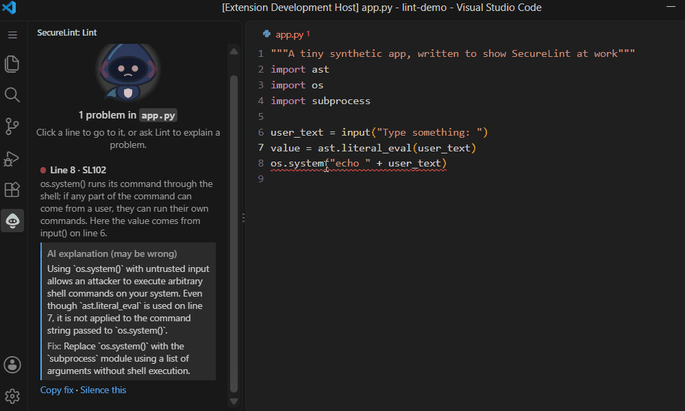
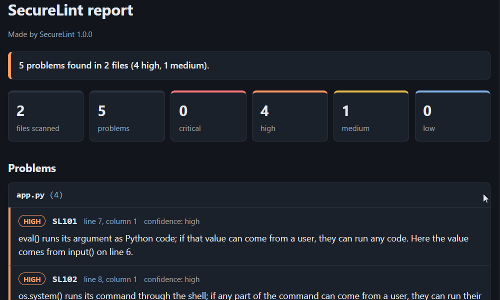
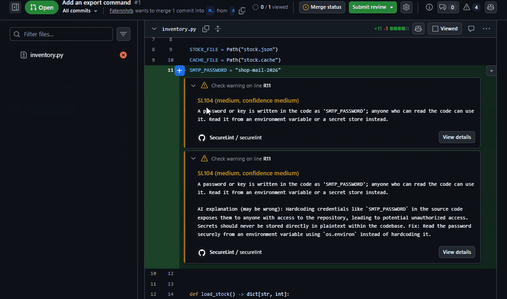
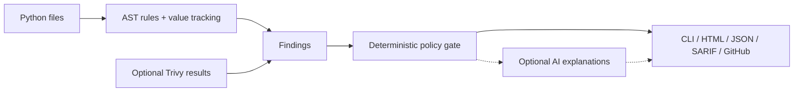

<p align="center">
  
</p>

<h1 align="center">SecureLint</h1>

<p align="center">
  <strong>Catch risky Python code. Explain the finding. Keep unsafe changes out of CI.</strong>
</p>

<p align="center">
  A lightweight Python security scanner with deterministic policy gates, GitHub pull request integration, and optional AI explanations.
</p>

<p align="center">
  <a href="https://pypi.org/project/securelint/"></a>
  <a href="https://github.com/Fatennhrb/SecureLint/actions/workflows/ci.yml"></a>
  <a href="LICENSE"></a>
</p>

<p align="center">
  <a href="#quick-start">Get started</a> ·
  <a href="#see-it-in-action">See it in action</a> ·
  <a href="#how-it-works">Architecture</a> ·
  <a href="#testing-and-evaluation">Evaluation</a> ·
  <a href="#documentation">Documentation</a>
</p>

---

## See it in action

<p align="center">
  <a href="assets/demo/demo-vscode.gif" title="Watch the real VS Code demonstration">
    
  </a>
</p>

<p align="center">
  <sub><strong>SecureLint for VS Code</strong> · Live security diagnostics, AI explanations, and Lint's interactive panel.</sub>
</p>

### More demos
Explore SecureLint through its CLI and GitHub Actions integration.

| Terminal → HTML report | GitHub pull request review |
|:---:|:---:|
| <a href="assets/demo/demo-terminal.gif"></a> | <a href="assets/demo/demo-pull-request.gif"></a> |
| [Watch the CLI and HTML report](assets/demo/demo-terminal.gif) | [Watch the PR checks](assets/demo/demo-pull-request.gif) · [Explore demo PR #1](https://github.com/Fatennhrb/securelint-demo/pull/1) |

## Quick start

Requires **Python 3.11+**. The published scanner has no runtime dependencies beyond the Python standard library.

```bash
pip install securelint
securelint scan .
```

A scan exits with **`0`** when nothing blocks, **`1`** when the configured policy blocks a finding, or **`2`** when it cannot complete. That makes SecureLint suitable for local checks and CI gates. [CLI options and report formats](docs/getting-started.md#usage).

## Why SecureLint?

| Analyze | Enforce | Explain |
|:---|:---|:---|
| Python AST rules with limited value tracking detect selected insecure patterns. | Policies, baselines, changed-line checks and GitHub annotations help teams gate risky changes. | Optional provider-independent AI explains findings and safer approaches without controlling the security verdict. |

Beyond Python source analysis, SecureLint can **ingest Trivy results** for vulnerable dependencies and unsafe Docker/configuration settings. Its GitHub Action can also run Trivy as an optional step.

- **Security rules:** runtime code execution, shell commands, unsafe deserialization, embedded secrets and SQL query construction. [Rules and limitations](docs/rules.md).
- **Developer workflows:** CLI, JSON, standalone HTML, SARIF and GitHub Actions annotations. [Reporting](docs/getting-started.md#usage) · [CI setup](docs/github-actions.md).
- **Incremental adoption:** configurable blocking thresholds, targeted suppressions and baselines. [Configuration](docs/configuration.md).
- **Optional AI:** explanations are appended *after* policy evaluation; a model failure cannot turn a blocked scan into a passing one. [Providers and privacy](docs/ai-explanations.md).

## How it works



**The policy engine owns pass/fail decisions.** AI can add context or suggestions but cannot override the gate. [Security threat model](docs/threat-model.md) · [Architecture details](docs/architecture.md).

## Testing and evaluation

The repository includes automated checks, an annotated test corpus, comparisons with Bandit, and experiments on real Python projects. **These are project evaluation results, not independent certifications of vulnerability-detection accuracy.**

| Project evaluation | Reported result | Context |
|:---|---:|:---|
| Dangerous cases found | **54 / 63** | In the project-authored corpus; 9 missed cases and 4 false alarms |
| Scan benchmark (v1.0.0) | **11.68 s** | 3,659 Python standard-library files; one Windows laptop, fastest of five runs |
| Real-project check | **4 projects** | Flask, Requests, HTTPie and Jinja; limited manual review of reported findings |

The benchmark covers five security categories using a project-specific test corpus. Results reflect these test cases rather than overall tool performance, as Bandit supports a broader range of security checks. Read the complete [detection results and Bandit comparison](docs/evaluation.md), [performance table and methodology](docs/performance.md), and [real-project findings](docs/real-projects.md).

## Release status

| Published | Development branch (`main`) |
|:---|:---|
| **[Python CLI 1.0.0 on PyPI](https://pypi.org/project/securelint/)** and the [GitHub Action pinned to `v1.0.0`](https://github.com/Fatennhrb/SecureLint/tree/v1.0.0) | Experimental **VS Code extension** with Lint, plus `securelint explain FILE --line N`; **not included** in the published Python 1.0.0 package |

The VS Code extension is **not on the Marketplace**. It can be built or installed from a CI artifact; see the [extension guide](editors/vscode/README.md) and [feature details](docs/vscode-extension.md). See [CHANGELOG.md](CHANGELOG.md) for version-specific changes.

## Documentation

Detailed documentation covering SecureLint's configuration, integrations, architecture, security analysis, benchmarks, and development workflows.

| Topic | Guide |
|:---|:---|
| Installation, CLI and output formats | [Getting started](docs/getting-started.md) |
| Settings, blocking rules, baselines and suppressions | [Configuration and policy](docs/configuration.md) |
| GitHub Action and changed-line analysis | [GitHub Actions](docs/github-actions.md) |
| Trivy dependency and Docker checks | [Trivy integration](docs/dependencies-and-trivy.md) |
| AI providers, redaction and explanation cache | [AI explanations](docs/ai-explanations.md) |
| Security rules, dataflow scope and confidence | [Detection rules](docs/rules.md) |
| VS Code extension and Lint | [Extension setup](editors/vscode/README.md) · [Details](docs/vscode-extension.md) |
| Corpus results and Bandit comparison | [Evaluation](docs/evaluation.md) |
| All version speed results and methodology | [Performance](docs/performance.md) |
| API/CLI stability commitments | [Compatibility](docs/compatibility.md) |
| Reproducible source code & extra evaluations | [Tests](tests/) · [Benchmarks](benchmarks/) · [Real-project analysis](docs/real-projects.md) |
| Architecture, threat model and security reporting | [Architecture](docs/architecture.md) · [Threat model](docs/threat-model.md) · [Security policy](SECURITY.md) |
| Changelog, release workflow and license | [Changelog](CHANGELOG.md) · [Releasing](docs/releasing.md) · [MIT license](LICENSE) |

---

<p align="center">
  <a href="https://pypi.org/project/securelint/">PyPI</a> ·
  <a href="https://github.com/Fatennhrb/securelint-demo">Live demos</a> ·
  <a href="CHANGELOG.md">Changelog</a> ·
  <a href="LICENSE">MIT License</a>
</p>
