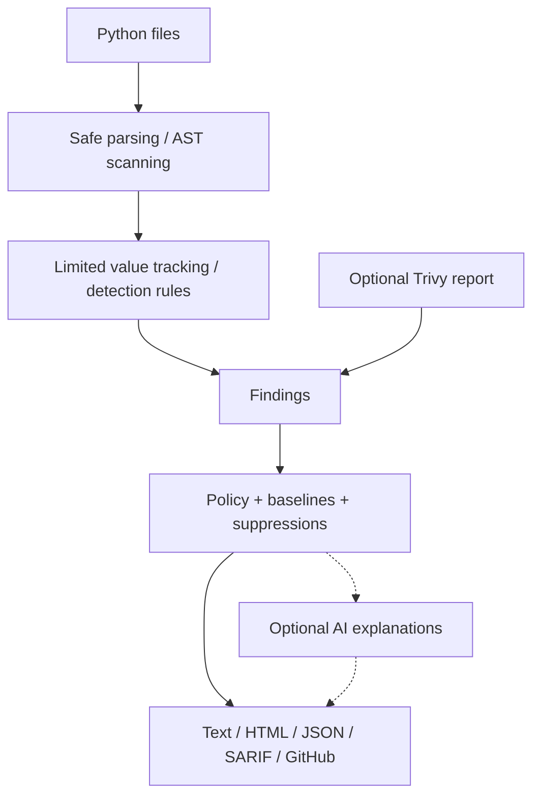

# SecureLint architecture

[← Return to the README](../README.md)

SecureLint scans selected Python source patterns and can ingest findings from Trivy. A separate policy stage decides which findings block. Reporters then present results locally or in GitHub CI. AI explanations, if configured, are added *after* the policy verdict and cannot change it.

## Architecture boundaries

- The built-in scanner focuses on five classes of Python security patterns. It is not a complete interprocedural taint engine.
- Trivy findings originate with Trivy; SecureLint integrates and enforces policy on its reports. The GitHub Action can invoke Trivy, while direct CLI integration reads an externally generated Trivy JSON report.
- On pull requests, changed-line reporting can omit findings affected indirectly by changes elsewhere; also scan the full project when appropriate.
- The model receives a small redacted context and can still make mistakes; its suggestions require developer review.
- Security policies use fixed rules and exits codes, never model output.

For implementation specifics, see [rules](rules.md), [configuration](configuration.md), [GitHub integration](github-actions.md), [AI behavior](ai-explanations.md), and the [threat model](threat-model.md).
