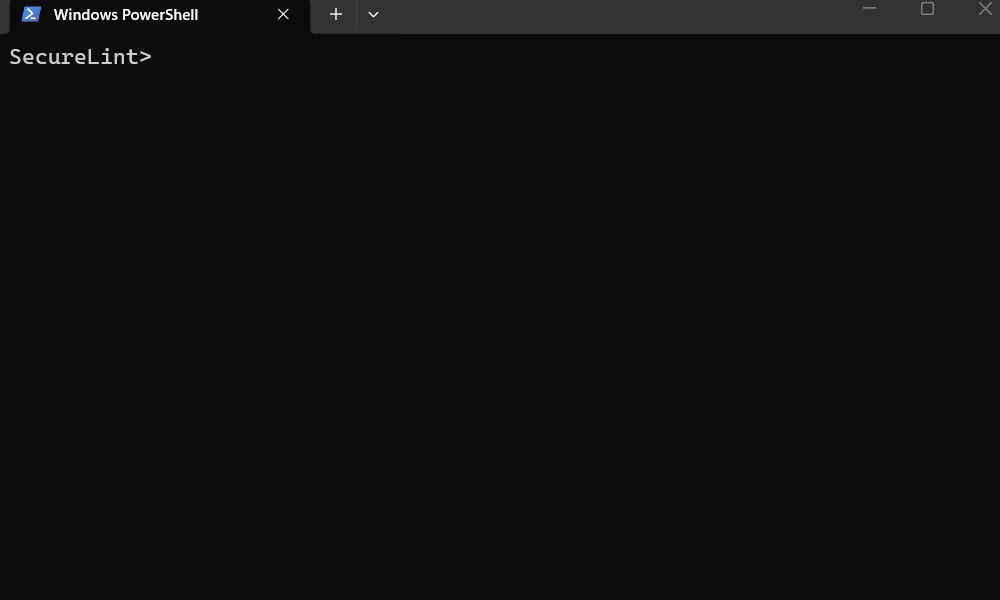

> [← Back to SecureLint overview](../README.md) · [Full original README snapshot](archive/README-original-2026-11-18.md)

> Installation, local use, development setup, reports and exit codes. These commands describe the published Python CLI unless noted otherwise.

## Installation

SecureLint needs Python 3.11 or newer, and nothing else:

```bash
pip install securelint
securelint scan
```

For explanations by Claude (see
[Explaining findings with an AI](ai-explanations.md#explaining-findings-with-an-ai)), install
Anthropic's package with it: `pip install "securelint[anthropic]"`.

Every release on PyPI is published by this repository's
[Release workflow](https://github.com/Fatennhrb/SecureLint/blob/main/.github/workflows/release.yml)
with digital attestations, which show that the files were built here.

## Development setup

```bash
python -m venv .venv
source .venv/bin/activate          # Windows PowerShell: .venv\Scripts\Activate.ps1
python -m pip install -e ".[dev]"
```

Checks to run before every commit:

```bash
python -m ruff check .            # lint
python -m ruff format --check .   # formatting (drop --check to apply it)
python -m mypy                    # type check (strict mode)
python -m pytest                  # tests
```

GitHub Actions runs the same four checks on every push to `main` and on every
pull request, on Python 3.11 and 3.14 (see [ci.yml](https://github.com/Fatennhrb/SecureLint/blob/main/.github/workflows/ci.yml)).

## Usage

```bash
securelint --version
securelint scan              # scan the current directory
securelint scan src/         # scan one directory
securelint scan app.py       # scan one file
securelint scan src/ --format json > report.json
securelint scan src/ --format html > report.html
securelint scan --format sarif > securelint.sarif
securelint scan --format github   # inside GitHub Actions
```

<p align="center">
  
</p>
<p align="center"><em>A scan finds 5 problems in 2 files and exits with 1, the code that
fails a CI job; the same result as an HTML report.</em></p>

`--format json` writes the same result as a JSON document for other programs
to read: a summary, then every finding with its rule, severity, confidence,
path, line, column and message, and the files that could not be scanned.

Each finding in the JSON report has a `fingerprint`: a short code built from
the rule, the file path and the text of the reported line, not its line number.
It stays the same when code is added or removed elsewhere in the file, and
changes when the reported line itself is edited.

`--format html` writes one page to open in a browser: a summary, then the
problems grouped by file. The page is a single file with its style inside. It
contains no script and loads nothing from the network, and every file name and
message is escaped before it is written into the page.

`--format sarif` writes SARIF 2.1.0, the standard format GitHub reads for
security tools. Uploaded to GitHub, the results appear in the repository's
Security tab and next to the changed lines of a pull request. Every finding is
written, with a level that follows the policy:

| SARIF level | Meaning |
|-------------|---------|
| `error` | The finding blocks. |
| `warning` | The policy reports it without blocking, or a comment silenced it (it is then also marked as suppressed). |
| `note` | The finding is listed in the baseline file (marked `"baselineState": "unchanged"`), or it is on a line the change did not touch (with `--changed-since`). |

Paths are written from the top of the project, whatever folder was scanned,
and each result carries its fingerprint so GitHub can follow it between scans.

`--format github` is meant for GitHub Actions. Each blocking finding is printed
as an error note and each warning as a warning note, in the form GitHub reads
by itself: they appear on the exact line of the pull request, without any
upload or extra permission. Known, silenced and out-of-change findings are only
counted. When GitHub gives a summary file (`GITHUB_STEP_SUMMARY`), SecureLint
also adds a table to the job's page with the verdict: passed, blocked or
incomplete. File names and messages are escaped, so a strange name cannot break
a note or create a fake one. GitHub limits how many notes it shows for one
step, so on a large project use SARIF as well.

The exit code tells a script or a CI job what happened:

| Code | Meaning |
|------|---------|
| 0 | The scan finished and nothing blocks. There may be warnings, if the project has a policy. |
| 1 | The scan finished and found at least one problem that blocks. |
| 2 | The scan could not be completed: wrong command line, a path that does not exist, or a file that could not be read or parsed. |
