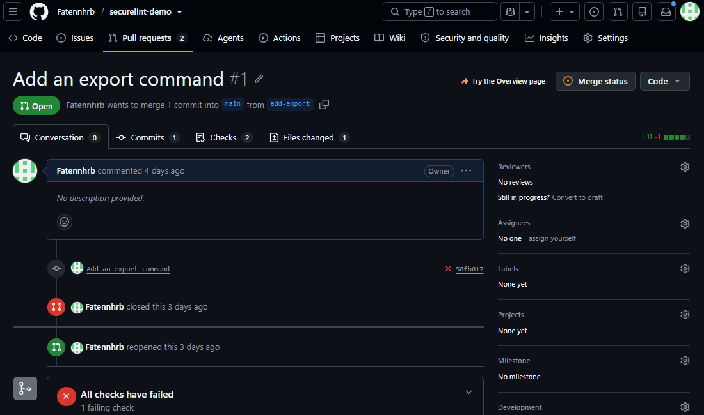

> [← Back to SecureLint overview](../README.md) · [Full original README snapshot](archive/README-original-2026-11-18.md)

> Configure GitHub CI to report findings on pull requests and fail when the chosen policy blocks changes.

## Using SecureLint in GitHub Actions

The repository is also a GitHub Action. Add this workflow to a project, as
`.github/workflows/securelint.yml`:

```yaml
name: SecureLint
on:
  pull_request:
  push:
    branches: [main]
permissions:
  contents: read
jobs:
  securelint:
    runs-on: ubuntu-latest
    steps:
      - uses: actions/checkout@3d3c42e5aac5ba805825da76410c181273ba90b1 # v7.0.1
        with:
          fetch-depth: 0 # the whole history, to find the changed lines
          persist-credentials: false
      - uses: Fatennhrb/SecureLint@v1.0.0 # pin the commit in real use
```

On a pull request, SecureLint reports the findings on the lines the pull
request changed, as notes on those lines, adds a summary table to the job's
page, and fails the check when the project's policy says something blocks. On
a push, it scans everything. It needs no token and no write permission.

See it on a real pull request in the demo repository:
[securelint-demo pull request #1](https://github.com/Fatennhrb/securelint-demo/pull/1)
fails because of a shell command built from typed input, shows a warning for
a hard-coded password, and leaves alone an old problem listed in its baseline.
[Pull request #2](https://github.com/Fatennhrb/securelint-demo/pull/2) runs
Trivy too: it fails on a Dockerfile that runs as `root`, and warns about four
known vulnerabilities in an old `requests`. The demo also explains its
findings with Gemini's free tier, so the notes on pull request #1 each carry an
AI explanation.

<p align="center">
  
</p>
<p align="center"><em>The two demo pull requests: notes with AI explanations on pull
request #1, Trivy's findings on pull request #2. On pull request #1 each note
appears twice: its commit was checked twice, before and after AI explanations
were turned on, and GitHub keeps the notes of both checks. The second note of
each pair carries the explanation.</em></p>

| Input | Default | Meaning |
|-------|---------|---------|
| `path` | `.` | File or directory to scan. |
| `changed-only` | `true` | On a pull request, report only the changed lines. |
| `sarif-file` | (empty) | Also write a SARIF report of the whole scan to this file. |
| `python-version` | `3.13` | Python used to run SecureLint. The job's own Python is not changed. |
| `trivy` | `false` | Also check dependencies and Dockerfiles with Trivy (Linux runners only). |
| `explain` | `false` | Add an AI explanation to the notes, from the project's `[tool.securelint.ai]` settings. |

To see the findings in the repository's Security tab as well, set
`sarif-file: securelint.sarif`, give the job the `security-events: write`
permission, and upload the file with the `upload-sarif` step of
`github/codeql-action`, pinned to a commit like the steps above. GitHub does
not let pull requests from forks upload SARIF; the notes on the lines still
work for them.

With `trivy: "true"`, the Action downloads Trivy 0.76.2 from its GitHub
release, checks the download against the checksum written in `action.yml`, and
runs it only if they match. Trivy then checks the same folder, and its report
is read as described in
[Checking dependencies and Dockerfiles with Trivy](dependencies-and-trivy.md#checking-dependencies-and-dockerfiles-with-trivy).
The version is pinned on purpose: Trivy's own release 0.69.4 was compromised in
March 2026 (CVE-2026-33634), so a new version is only used after it has been
checked and the pin changed.

With `explain: "true"`, each note also holds an AI explanation, as described
in [Explaining findings with an AI](ai-explanations.md#explaining-findings-with-an-ai). The AI is
the one set up in the project's settings; its key comes from a repository
secret, given to the step under the name the settings use:

```yaml
      - uses: Fatennhrb/SecureLint@v1.0.0 # pin the commit in real use
        with:
          explain: "true"
        env:
          ANTHROPIC_API_KEY: ${{ secrets.ANTHROPIC_API_KEY }}
```

Only the scan for the notes asks the AI; the SARIF report is written without
explanations, so nothing is paid for twice. Pull requests from forks get no
secrets: their notes simply come without explanations, and the check works as
usual. Each explained finding is a paid request to the provider, unless it has
a free tier or runs on your own machine. Anthropic's package is installed only
when the project's settings choose the `anthropic` provider.

The Action installs SecureLint from its own files, so `@v1.0.0` always runs
SecureLint 1.0.0. The `trivy` input exists from version 0.5.0, and `explain`
from 0.6.0. Settings, silencing comments, the baseline and the policy are read
from the scanned project as usual.

## Checking only what a change touched

```bash
securelint scan --changed-since main
```

SecureLint asks Git which lines the current branch added or changed since it
left `main`, including changes not committed yet, and reports only the findings
on those lines. A file Git does not track yet counts as changed in full.
Findings elsewhere are counted (`Outside the changed lines: 5.`) and listed in
the JSON, HTML and SARIF reports, but they do not change the exit code.

Settings, silencing comments, the baseline and the policy all still apply.

If Git is missing, the folder is not in a Git repository, or the branch cannot
be found, the scan stops with exit code 2: reporting nothing would look like a
clean change. In GitHub Actions, check out the whole history
(`fetch-depth: 0`), or Git cannot find where the branch started.

A change can make an unchanged line dangerous, for example by changing a value
that line reads. Such a finding is counted as outside the change, so run the
full scan as well, for example on `main` after each merge.
